# Beanjar

Beanjar boots stock LG webOS, NetCast 4.5 and SimpleSmart TV firmware in QEMU from firmware
you supply. LG's services and 32-bit ARM userland run on an arm64 guest kernel.
Beanjar supplies the hardware interfaces they expect. It can run with virgl graphics and a
GTK viewer, or headless. A VM manager keeps each TV's firmware, state and identity separate.

## Supported firmware

Each firmware has a fixed target, its SoC and webOS release. Import rejects other models; see
[firmware profiles](docs/dev/architecture/firmware-targets.md) for board configuration and bring-up details.
“Passed” below means the graphics regression completed boot, `check-m1`, tvservice app calls,
the bring-up checklist and a screenshot. It does not imply every TV feature works.

| Firmware | SoC / vendor | webOS release | Target | Status |
|---|---|---|---|---|
| WT1H 05.06.10.01 | H13 (LG1154) / LG | 1.4.0 (afro-ashley) | `h13-afro` | Passed; board 49UB850V-ZA |
| W15M 04.06.75.01 | M14 / LG | 2.2.3 (beehive-biscayne) | `m14-beehive` | Passed; board 42LF652V-ZA |
| W16R 05.70.50.01 | MSD93F2G (M2) / MStar | 3.4.3 (dreadlocks-digya) | `m2-dreadlocks` | Passed; board 43LH604V-ZB |
| W17H 06.10.65.01 | M16P (LG1313) / LG | 3.9.3 (dreadlocks2-dudhwa) | `m16p-dreadlocks2` | Passed; board 55UJ750V-ZA |
| W18R 05.50.70.01 | M5621 (M3) / MStar | 4.4.3 (goldilocks-gorongosa) | `m3-goldilocks` | Passed, including Quick Start+; board 32LK6100PLB |
| W19P 05.40.97.01 | RTD2872 (K5LP) / Realtek | 4.10.2 (goldilocks2-grampians) | `k5lp-goldilocks2` | Passed, including Quick Start+; board 43UM7500PLA |
| W20L 04.63.25.01 | K6LP / Realtek | 5.6.1 (jhericurl-jimna) | `k6lp-jhericurl` | Passed; board 32LX6900PJA |
| W21P 03.70.25.01 | RTD2875 (K7LP) / Realtek | 6.6.0 (kisscurl-kolovesi) | `k7lp-kisscurl` | Passed; board 43UP77009LB |

The [regression runner](docs/dev/guides/build.md#regression-runs) tests the webOS targets sequentially with
graphics or in parallel headless lanes. It checks Quick Start+ standby and resume where
supported. The latest graphics batch passed all eight rows; standby passed on W16R, W17H,
W18R and W19P, and was skipped on WT1H, W15M, W20L and W21P by the guest capability checks.
The [firmware
profiles](docs/dev/architecture/firmware-targets.md) list the feature coverage of each target.

### Legacy firmware

These stock legacy interfaces use their own graphics and service layers. Their bounded
functional checks differ from the webOS regression suite; see the
[NetCast 4.5](docs/dev/architecture/netcast45.md) and [SimpleSmart](docs/dev/architecture/simplesmart.md)
designs.

| Firmware | Platform | Target | Verified coverage |
|---|---|---|---|
| NC5U / LM14 US 04.11.18.01 | NetCast 4.5 | `lm14-netcast45` | Stock OSD, MyApps, Picture settings and FX HOME navigation; visually accepted. |
| SS1A 04.10.06.01 | SimpleSmart | `m2-simplesmart` | Stock HOME ribbon and process continuity during a bounded smoke test. |

## Screenshots

These 1920 × 1080 regression grabs are reduced to 960 × 540. The black TV area in several shots
is the video plane with no signal; the launcher is rendered above it.

| | |
|---|---|
| 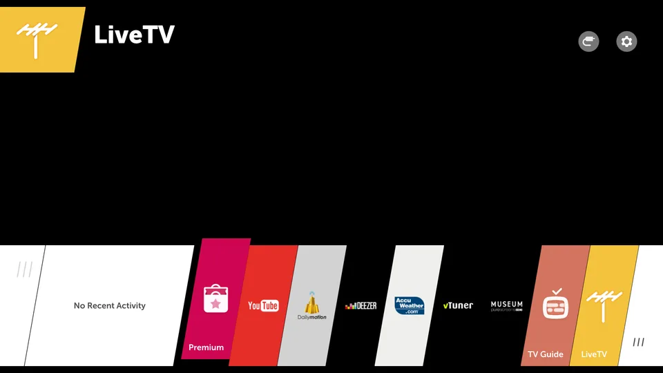<br>**WT1H · webOS 1:** Home launcher over Live TV. | 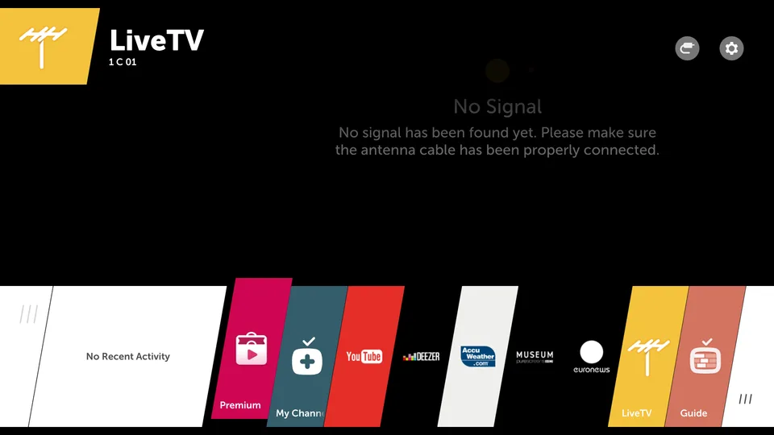<br>**W15M · webOS 2:** Home launcher over Live TV's No Signal screen. |
| 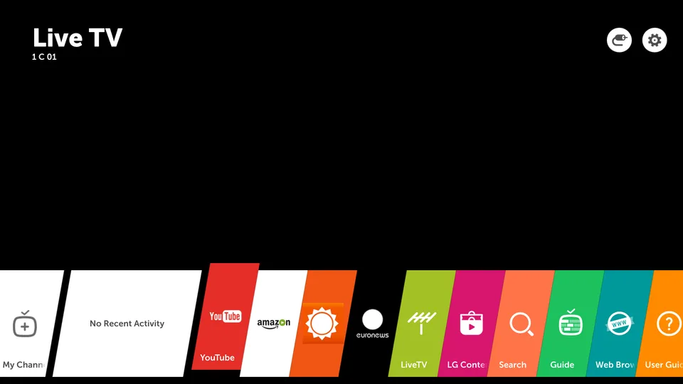<br>**W16R · webOS 3:** Home launcher over Live TV. | 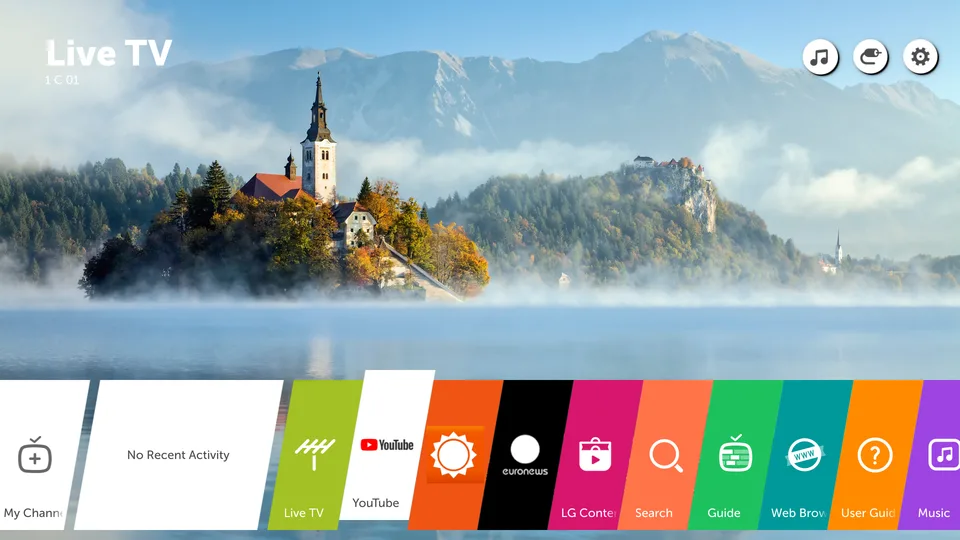<br>**W17H · webOS 3.5:** Home launcher over a landscape background. |
| 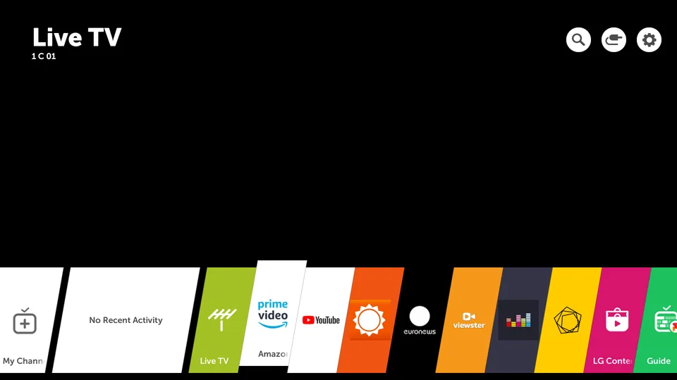<br>**W18R · webOS 4:** Home launcher over Live TV. | 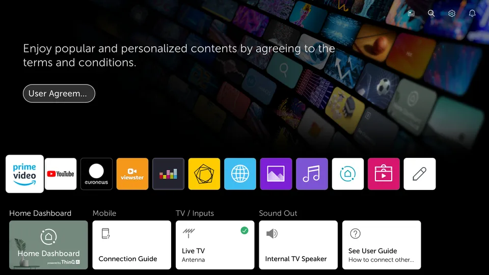<br>**W19P · webOS 4.5:** Home dashboard with apps, inputs and sound output. |
| 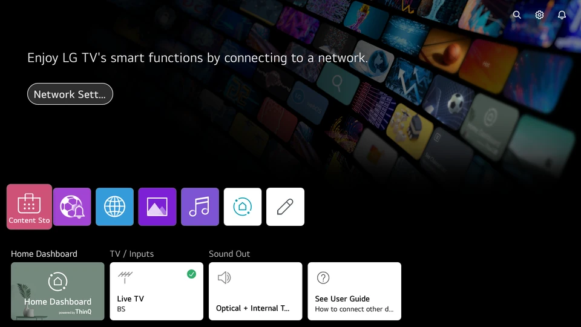<br>**W20L · webOS 5:** Stock Home with apps, inputs and sound output; network offline. | 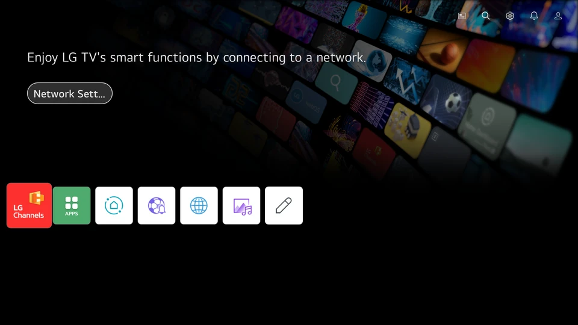<br>**W21P · webOS 6:** Stock Home with LG Channels and Apps; network offline. |

### Legacy interfaces

Original Pi captures, presented at 960 × 540. The black TV areas have no input signal.

| | |
|---|---|
| 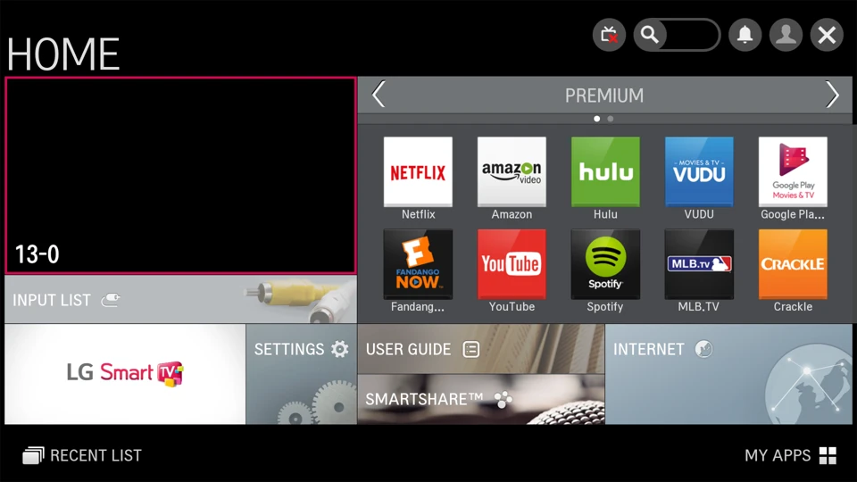<br>**NC5U · NetCast 4.5 · 04.11.18:** Stock FX HOME dashboard with Premium apps, inputs and settings. | 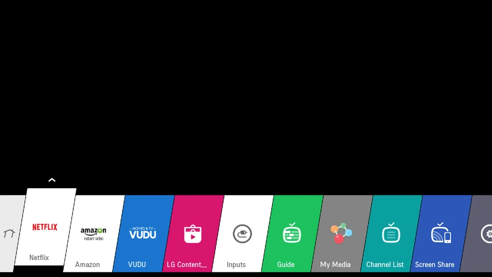<br>**SS1A · SimpleSmart · 04.10.06:** Stock HOME ribbon over the black video area. |

### Beanjar windows

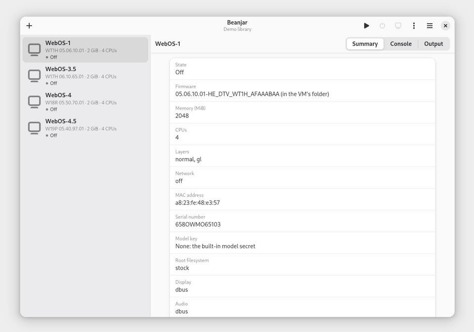

**Manager:** Four stopped demo VMs, from webOS 1 to 4.5, in the GTK manager's Summary view.

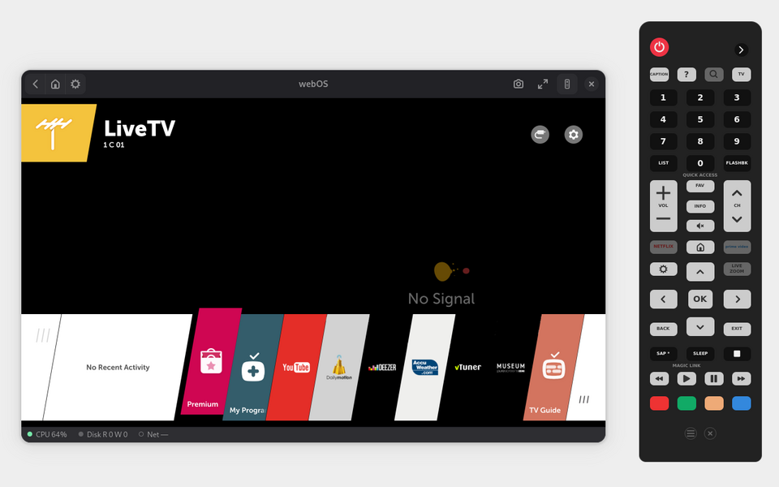

**Viewer:** A running WT1H guest shows Home over Live TV's black video plane and No Signal
message, beside Beanjar's on-screen remote. The header and status bar surround the TV picture.

## Quick start

Use Debian 13 on an x86_64 machine to build the host tools and each firmware's guest layer.
Install the packages and guest SDK described in [Host
packages](docs/dev/guides/build.md#host-packages), then
provide your own LG `.epk` or an extracted directory of paks. The GUI can extract an `.epk` with
[epk2extract](https://github.com/openlgtv/epk2extract); the CLI takes an extracted directory.
No firmware, keys or model secrets are included in this repository.

```sh
scripts/build.sh host
# Guest build for webOS or SimpleSmart:
FW=/path/to/extracted-paks scripts/build.sh guest
```

webOS and SimpleSmart use `meson/cross/webos-sdk.ini`. NetCast 4.5 uses the separate
[lgtv Buildroot SDK](https://github.com/openlgtv/buildroot-nc4), configured in
`meson/cross/lgtv-sdk.ini`. Before its first guest build, create the NetCast build directory
with that cross file; subsequent `scripts/build.sh guest` runs reuse it:

```sh
meson setup --cross-file meson/cross/lgtv-sdk.ini build/guest-lm14-netcast45 \
  -Dsoc=lm14 -Dwebos=netcast45 -Dfirmware=/path/to/extracted-lm14-paks
meson compile -C build/guest-lm14-netcast45
```

Run locally with QEMU's TCG on x86_64, or sync the published guest build to a Raspberry Pi 5
running Debian 13 for KVM. Build the host side on the Pi too:

```sh
# Local TCG: run on x86_64
PYTHONPATH=host/core:host/ui python3 -m beanjar_ui.manager

# Raspberry Pi 5: copy this checkout and the published guest build to the Pi (rsync, git, ...),
# then run the next two commands there (its firmware comes from its own firmware
# collections, `/srv/beanjar/firmware` by default; not copied)
scripts/build.sh host
PYTHONPATH=host/core:host/ui python3 -m beanjar_ui.manager
```

In the manager, choose **New VM**, supply the `.epk` or extracted paks, then **Start** and
**Connect**. The manager also has a CLI:

```sh
export PYTHONPATH=host/core
python3 -m beanjar create tv1 --firmware /path/to/extracted-paks --import
python3 -m beanjar start tv1
python3 -m beanjar viewer open tv1 --remote
python3 -m beanjar stop tv1
```

`python3 -m beanjar --help` lists other commands, including `list`, `info`, `settings`, `key model`
and `identity renew`; `--json` gives any command's result as JSON. The manager keeps VMs under `~/.local/share/beanjar` by default; see its
[guide](host/core/README.md) for library settings. `host/scripts/vm-launcher --help` describes the lower-level
checkout VM launcher.

### What to expect

The GTK viewer shows the TV picture and on-screen LG remote; pointer support depends on
the platform. webOS and NetCast use Mesa for EGL/GLES, while SimpleSmart uses software GX
surfaces and GOP presentation. Legacy firmware has bounded UI coverage as listed above.
The video plane can be decoded on the host with FFmpeg; WT1H has measured guest audio and
media playback. Other targets' audio and playback have more limited or untested coverage.
Live TV has no tuner, so a No Signal screen is expected. Protected video (Widevine and
PlayReady) is outside the project scope.

The default network uses a mitmproxy inspector at `http://127.0.1.N:18083`; `direct` and
`off` are also available. The webOS guest layers `rootssh` and `devmode` expose local
ports (6622 and 9922/9991); `hbchannel` (with `devmode`) installs Homebrew Channel as on a rooted TV, with its root
SSH on 6622 instead of `rootssh`. Each VM has its own loopback address, `127.0.1.N` (its slot), with
these stock port numbers, so several VMs run at once as far as the host's free memory allows. A webOS VM without a user-supplied SDP model key has a synthetic secret that LG's
servers do not accept. The [manager guide](host/core/README.md) explains these
settings and each VM's identity.

The x86_64 host uses TCG; a Raspberry Pi 5 uses KVM. An aarch64 host needs AArch32 at EL0 for
KVM; otherwise it needs TCG. On WSL2, the host build uses a patched QEMU for virgl through
Mesa's d3d12. See [Host packages](docs/dev/guides/build.md#host-packages) for setup details.

## Documentation

- [Using Beanjar](docs/user/README.md): getting started, creating and running VMs, the viewer,
  VNC, the web viewer and the remote, apps, and logs. The [VM manager guide](host/core/README.md)
  is the reference for every command and setting.
- [Developing Beanjar](docs/dev/README.md): building, testing, coverage and packaging, and the
  architecture: one page per topic with its current contracts and decisions.

## Licence

Beanjar is free software under the GNU General Public License, version 2 or (at your option)
any later version (GPL-2.0-or-later); see [LICENSE](LICENSE).
